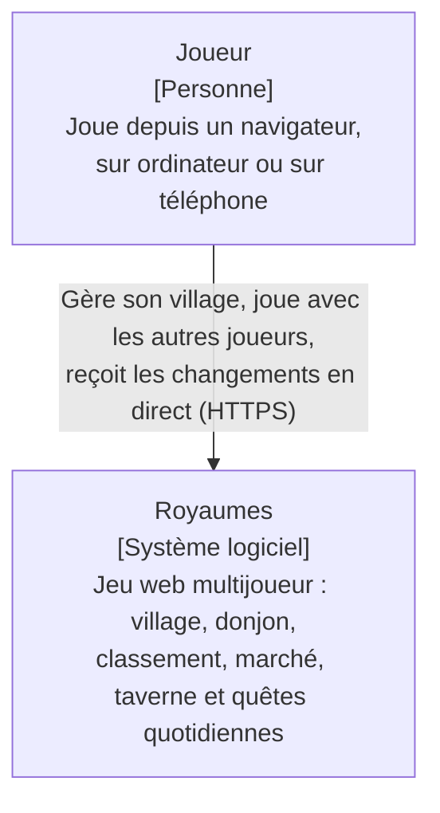
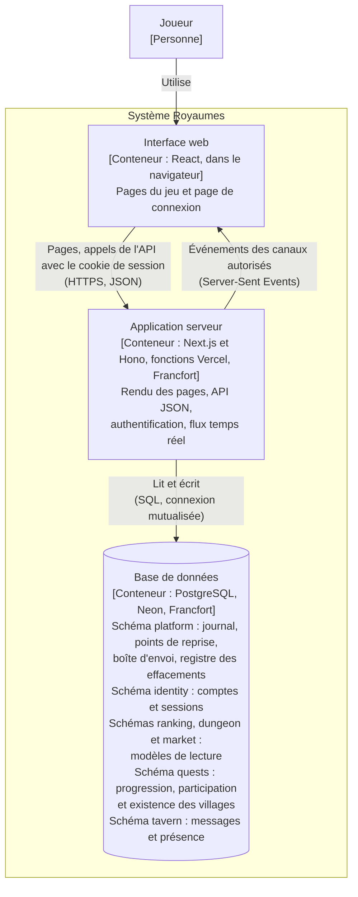
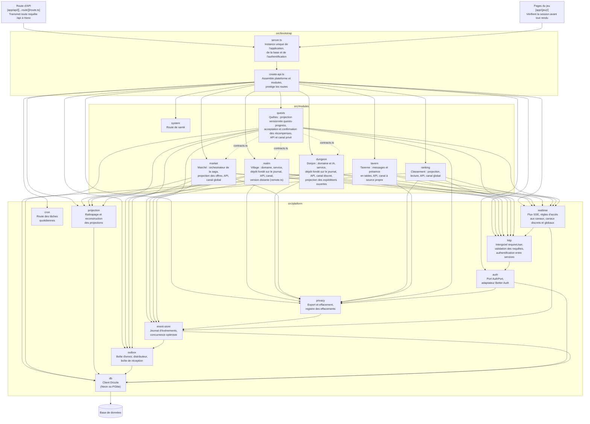
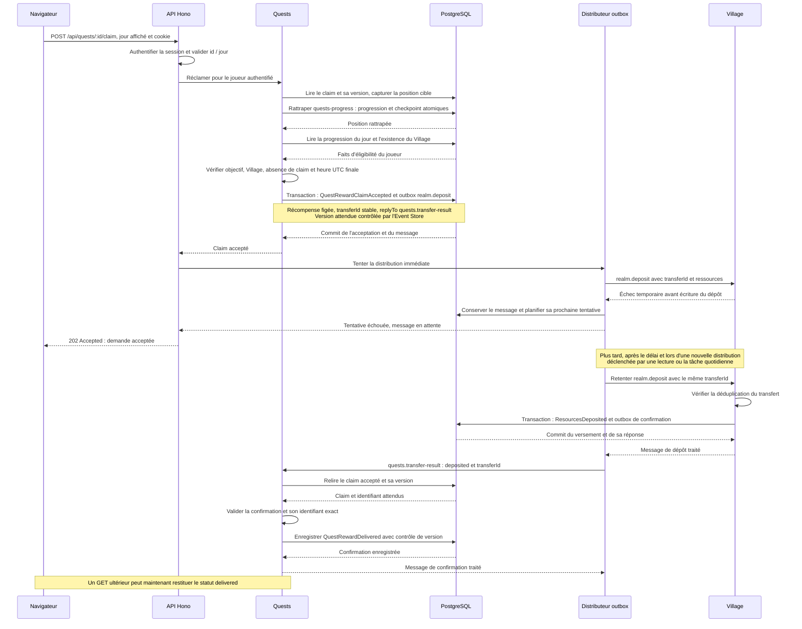
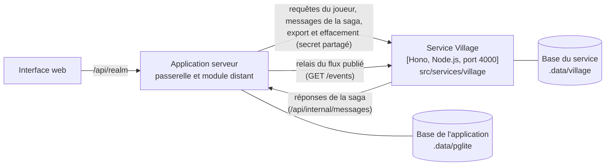
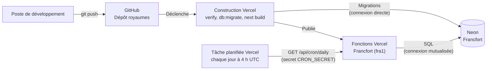

# Architecture de Royaumes

Ce document décrit la structure du système selon le modèle C4, du plus général au plus
détaillé. Les raisons des choix qui y apparaissent sont consignées dans les
[décisions d'architecture](adr/README.md).

Les diagrammes sont rédigés en Mermaid : ils sont versionnés avec le code, et mis à jour
dans le même commit que la modification qu'ils décrivent.

## Niveau 1 - Contexte

Royaumes ne dépend d'aucun système externe : il n'envoie aucun courrier électronique et
ne fait appel à aucun service de paiement ni à aucun fournisseur d'identité. Les comptes
des joueurs sont gérés par le système lui-même.

## Niveau 2 - Conteneurs

| Conteneur | Technologies | Responsabilités |
| --- | --- | --- |
| Interface web | React, composants des modules (`ui.tsx`) | Affichage des vues, envoi des actions du joueur, abonnement aux canaux temps réel |
| Application serveur | Next.js, Hono, Better Auth, Drizzle | Contrôle d'accès, règles du jeu, enregistrement des événements, diffusion des flux |
| Base de données | PostgreSQL (Neon en production, PGlite en local et en test) | Conservation du journal d'événements, des comptes et des sessions ; modèles de lecture des modules |

Le journal d'événements est la seule source de vérité des modules Village, Donjon et Marché.
La Taverne n'enregistre pas d'événements : ses tables sont sa propre source de vérité (ADR 0008).
Les tables des schémas `ranking`, `dungeon`, `market` et `quests` sont des modèles de lecture, dérivés du journal par des projections : elles peuvent
être vidées puis reconstruites à tout moment, sans perte d'information.

Le schéma `quests` contient `daily_progress`, `game_players`, `trade_participants` et
`villages`. Les acceptations et confirmations de récompenses restent dans
`platform.events` : leur historique fait autorité, et le statut de récompense est calculé,
sans table supplémentaire. Quests appartient au même monolithe et utilise la même base ;
ce n'est pas un service déployé séparément ([ADR 0010](adr/0010-daily-quests-persistence.md)).

L'interface web ne communique jamais directement avec la base : toute lecture et toute
écriture passent par l'application serveur, qui applique le contrôle d'accès.

## Niveau 3 - Composants de l'application serveur

Une flèche signifie « dépend de ». Le diagramme ne montre que les dépendances principales :
`server.ts` crée également lui-même la base, le journal et l'adaptateur d'authentification,
qu'il transmet à `create-api.ts`. Les modules `dungeon`, `ranking`, `market` et `quests` écrivent directement
dans leurs propres tables, au sein de la transaction fournie par le moteur des projections.
Les flèches en pointillés de Quests désignent uniquement des dépendances aux contrats
publiés, pas des appels aux services internes des modules de jeu.

Le module `ranking` lit des événements du Village et du Donjon, mais n'importe aucun de leurs
fichiers en dehors de leurs contrats : il ne dépend que de leur langage publié, c'est-à-dire
du nom et des données de leurs événements, ainsi que du préfixe de leurs flux.

Le module `market` modifie les villages sans jamais importer le code du Village : il enregistre
des messages dans la boîte d'envoi, que le distributeur remet aux gestionnaires du Village.
La seule dépendance directe porte sur les contrats du Village (`REALM_TOPICS`, `ResourceAmounts`),
qui décrivent ces messages. Chaque transaction ne modifie que les données d'un seul module,
et la boîte d'envoi (ADR 0007).

Chaque module déclare ses données personnelles à la brique `privacy`, au moyen d'un fichier
`personal-data.ts` : il les exporte et fournit les traitements de réécriture ou d'effacement
prévus par sa politique. Quests conserve après suppression de l'identité ses références,
sa progression et l'historique de ses récompenses sans noms, nécessaires au rejeu et au
règlement. Cette conservation est pseudonyme, sans anonymisation complète ni suppression physique
([ADR 0010](adr/0010-daily-quests-persistence.md)).
La brique `privacy` contient la seule fonction du projet qui modifie un
événement enregistré : la réécriture ciblée des champs personnels, lors de la suppression
d'un compte (ADR 0008).

Les règles suivantes sont vérifiées automatiquement par
dependency-cruiser (`.dependency-cruiser.cjs`) à chaque exécution de `pnpm verify` :

- la plateforme ne dépend d'aucun module ;
- un module n'est accessible que par ses entrées publiques (`index.ts`, `contracts.ts`, `ui.tsx`) ;
- le domaine d'un module ne dépend d'aucune bibliothèque technique ;
- la couche application d'un module ne dépend pas de sa couche infrastructure ;
- le code destiné au navigateur ne dépend d'aucun code serveur ;
- aucune dépendance circulaire n'est admise ;
- un module n'importe jamais les tables de la plateforme : il passe par ses fonctions ;
- Quests n'importe le Village, le Donjon et le Marché que par `contracts.ts`
  (`quests-gameplay-contracts-only`).

Deux fonctions d'aptitude complètent ces règles, sous la forme de tests
(`src/bootstrap/architecture.test.ts`) : chaque table est rangée dans le schéma d'une brique
de la plateforme ou d'un module, et chaque module qui conserve des données déclare ses
données personnelles.

Seule la racine de composition connaît à la fois la plateforme et l'ensemble des modules.

### Quêtes quotidiennes : communication et règlement des récompenses

La projection versionnée `quests-progress` observe les événements publiés du Village,
du Donjon et du Marché. Elle crédite `BuildingUpgraded`, `GameEnded` et `TradeCompleted`
à leur date UTC de jeu (`data.at`), avec un point de reprise atomique. Les événements
antérieurs identifient les participants humains du Donjon et le vendeur/acheteur courant
du Marché ; un paiement refusé libère la place de l'acheteur avant une nouvelle acceptation.
Les compagnons ne reçoivent pas de progression. Le changement de jour sélectionne de
nouveaux compteurs, sans tâche de remise à zéro.

Une demande de récompense authentifiée utilise la progression projetée et l'existence
du Village, après rattrapage, mais consulte les claims directement dans le journal.
L'acceptation et le message `realm.deposit` sont atomiques ; le versement et sa confirmation
constituent des transactions ultérieures. L'identifiant stable du transfert permet au
Village de dédupliquer les dépôts. Quests ne marque la récompense comme versée qu'après
une confirmation `deposited` correspondant au claim accepté et à son identifiant exact ;
les confirmations répétées sont ignorées.

Le scénario suivant montre un échec temporaire de la première distribution, puis un
versement lors d'une distribution ultérieure. Le premier essai précède la réponse HTTP ;
il peut aussi réussir immédiatement. Dans les deux cas, `202 Accepted` confirme uniquement
l'acceptation durable, jamais le versement. Le stockage des événements et de leurs
messages associés passe par l'Event Store de la plateforme.

Le canal privé `quests` filtre ses notifications selon la session et n'envoie que des
invalidations neutres `QuestsChanged`, sans identifiants de flux de jeu ni contenu métier.
Le navigateur relit `GET /api/quests` ; il actualise aussi à la reconnexion, au retour du
focus et à minuit UTC. La notification ne prouve pas le versement : l'historique des
acceptations et des confirmations fait autorité pour les statuts `pending` et `delivered`.
Une notification peut manquer si une transaction est validée derrière le curseur SSE.
Les lectures et nouveaux claims retournent `503 QUESTS_NOT_READY` si le rattrapage est
incomplet ; un événement arrivé après le saut d'un trou du journal peut nécessiter une
reconstruction. Les reprises de livraison sont bornées et dépendent d'appels ultérieurs
au distributeur ; aucun délai de versement n'est garanti. Les décisions et leurs limites
sont détaillées dans les [ADR 0010](adr/0010-daily-quests-persistence.md) et
[0011](adr/0011-daily-quests-communication.md).

## Extraction du Village

Le Village peut s'exécuter dans un service autonome, distinct de l'application serveur
(ADR 0009). Cette configuration n'est utilisée qu'en local, lorsque les variables
`REALM_SERVICE_URL` et `SERVICE_SECRET` sont définies ; elle n'est pas déployée.

L'application reçoit alors une version distante du module Village (`remote.ts`), de même
forme que la version exécutée dans le processus : le reste de l'application ne voit pas la
différence. Le relais recopie les événements publiés par le service dans le journal de
l'application, où le Classement et le canal temps réel du village continuent de les lire.
Le service est assemblé par sa propre racine de composition, `src/services/village`, qui
n'utilise le module Village que par son point d'entrée public.

## Niveau 4 - Code

Ce niveau n'est pas dessiné : il est décrit par le code lui-même et par ses tests, que
tout diagramme maintenu à la main ne tarderait pas à contredire.

## Déploiement

Chaque envoi sur la branche `main` déclenche un déploiement. Le code n'est publié que si
l'ensemble des contrôles a réussi, et les migrations ne sont appliquées qu'après ces contrôles.

La tâche planifiée, déclarée dans `vercel.json`, exécute chaque jour les tâches quotidiennes :
la distribution des messages restés en attente dans la boîte d'envoi, et l'application des
durées de conservation de la Taverne. Elle ne s'exécute que sur le déploiement de production.

Le service Village extrait n'est pas déployé : en production, le Village s'exécute dans
les fonctions Vercel, comme les autres modules (ADR 0009).
